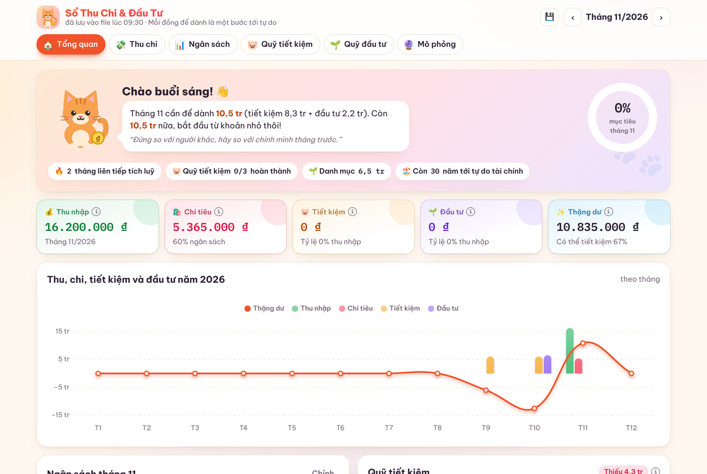
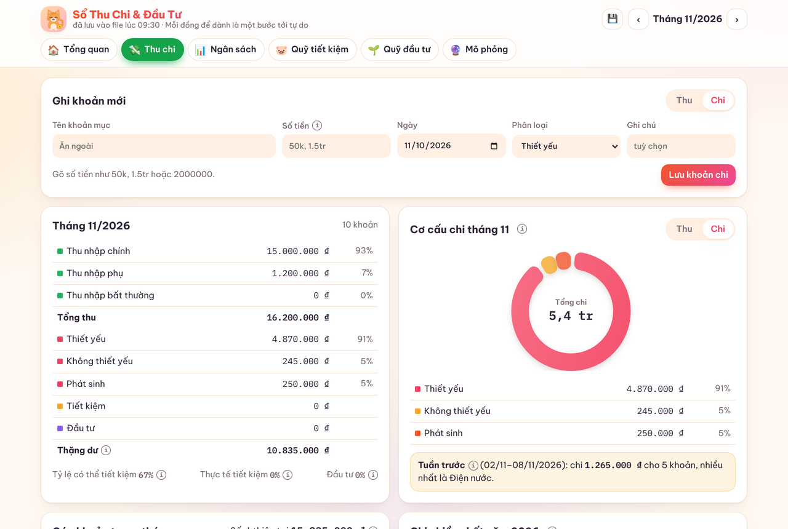
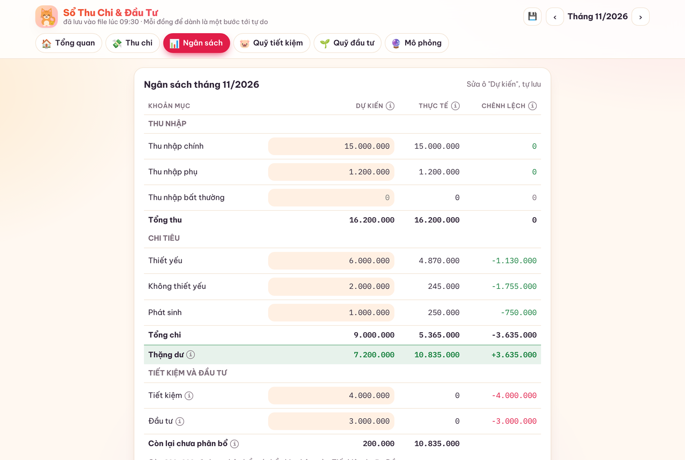
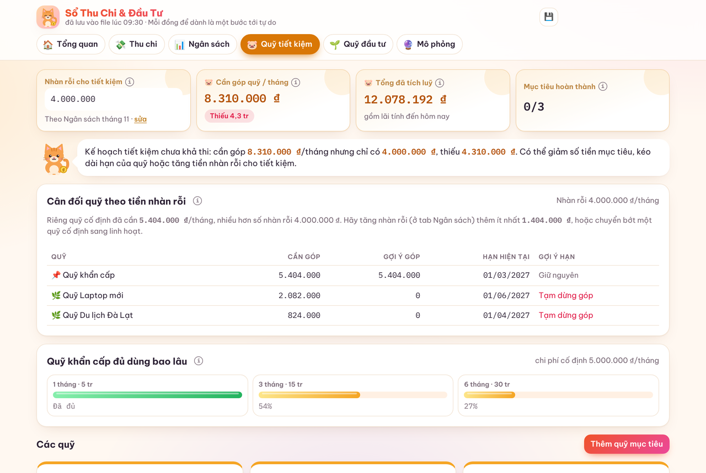
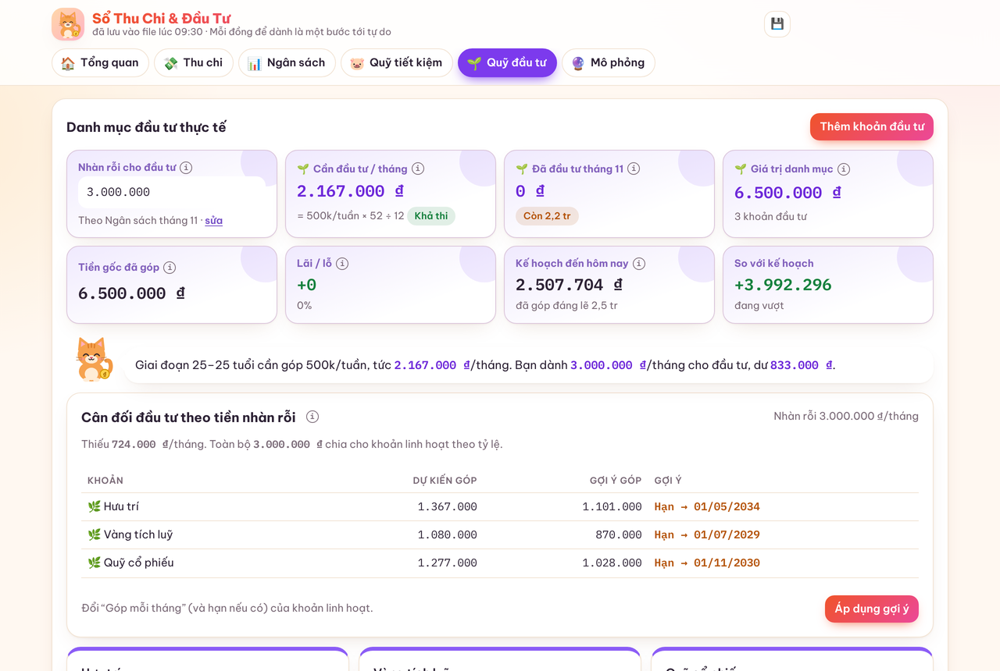

<div align="center">

# 🐱 Sổ Thu Chi & Đầu Tư

**Ứng dụng quản lý tài chính cá nhân chạy offline trên Windows. Ghi thu chi, lập ngân sách, xây quỹ tiết kiệm và theo dõi đầu tư trong một nơi, dữ liệu mã hoá và chỉ nằm trên máy bạn.**




</div>

## Vì sao có app này?

Phần lớn app tài chính đều bắt đăng nhập, đẩy dữ liệu lên mây hoặc thu phí theo tháng. Sổ Thu Chi & Đầu Tư đi theo hướng ngược lại:

- **Riêng tư tuyệt đối**: không tài khoản, không máy chủ, không quảng cáo. Mọi thứ nằm trong một file trên máy bạn.
- **Theo cách người Việt quản lý tiền**: chia thu nhập theo Thiết yếu, Không thiết yếu, Phát sinh; tính Thặng dư để quyết định tiết kiệm và đầu tư; vàng tính theo chỉ; lãi suất so sánh được với các kỳ hạn gửi tiết kiệm.
- **Không chỉ ghi chép mà còn gợi ý**: app tự tính mỗi tháng cần góp bao nhiêu, cảnh báo khi phân bổ vượt khả năng, và đề xuất lùi hạn quỹ nào khi tiền không đủ.

## Tính năng

### 💸 Thu chi
- Ghi nhanh bằng cách gõ `50k`, `1.5tr`, `2000000`.
- **Số dư sau mỗi khoản** như sao kê ngân hàng, có ô đối chiếu với số dư thật.
- **Thanh tách theo ngày**: tổng thu, tổng chi và số dư cuối ngày, ngày hôm nay được tô nổi.
- Sửa và xoá khoản đã nhập; khoản góp quỹ hoặc đầu tư liên kết được cập nhật theo.
- Biểu đồ cơ cấu chi tiêu và tóm tắt tuần trước.



### 📊 Ngân sách
- Bảng ngân sách 12 tháng theo nhóm thu và chi.
- Dòng **Thặng dư** và **Còn lại chưa phân bổ** cho biết còn bao nhiêu để tiết kiệm và đầu tư.
- Ô nhập vượt mức tự tô đỏ, kèm cảnh báo khi chi vượt thu hoặc tiết kiệm + đầu tư vượt thặng dư.
- Ngân sách là nguồn tự động cho số tiền nhàn rỗi ở tab Quỹ (vẫn sửa tay được).



### 🐷 Quỹ tiết kiệm
- Quỹ khẩn cấp (tính theo số tháng chi phí cố định) và các quỹ mục tiêu có hạn, lãi suất.
- Mỗi quỹ đánh dấu **📌 Cố định** hoặc **🌿 Linh hoạt**.
- **Cân đối theo tiền nhàn rỗi**: khi không đủ tiền, app ưu tiên quỹ cố định và gợi ý lùi hạn quỹ linh hoạt. Bấm một nút để áp dụng.



### 🌱 Quỹ đầu tư
- Theo dõi tiền gốc, giá trị hiện tại, lãi/lỗ và so với kế hoạch.
- Mỗi khoản hiện **cần góp mỗi tháng** để đạt mục tiêu đúng hạn.
- **Vàng theo chỉ**: nhập giá mua/bán, app quy đổi số tiền góp ra chỉ và định giá theo giá mua vào.
- **So sánh lãi suất**: bảng giá trị tương lai theo nhiều mức lãi (ví dụ các kỳ hạn tích luỹ), tự sửa được.
- Link tra giá nhanh: vàng (SJC, PNJ, BTMC), cổ phiếu (SSI, CafeF, Vietstock), trái phiếu (HNX), NAV quỹ (Fmarket, Dragon Capital, VinaCapital).



### 🔮 Mô phỏng
Mô phỏng lộ trình tới tự do tài chính theo từng giai đoạn cuộc đời: tuổi, mức góp, tăng trưởng, lạm phát và lương hưu.

### ✨ Và một chút "tiền tài về"
Hào quang vàng, đồng xu bay vào túi 💰, lì xì và cỏ bốn lá, câu khẳng định xoay vòng, mưa xu mỗi khi ghi khoản thu. Tắt được bằng nút ✨, và tự tắt khi Windows bật chế độ giảm chuyển động.

## 🔒 Bảo mật và dữ liệu

| | |
|---|---|
| Mã hoá | PBKDF2 + AES-256-GCM, khoá bằng mật khẩu bạn đặt |
| Nơi lưu | `so-tai-chinh-data.json` cạnh app, ghi an toàn (file tạm rồi đổi tên) |
| Sao lưu | Tự động mỗi ngày vào `sao-luu/`, giữ 30 bản gần nhất |
| Mạng | Không gửi dữ liệu đi đâu; link ngoài chỉ mở trong trình duyệt khi bạn bấm |

> ⚠️ Quên mật khẩu là không mở lại được dữ liệu. Hãy ghi mật khẩu ở nơi an toàn.

<p align="center"></p>

## 🚀 Cài đặt nhanh

Cần [Node.js](https://nodejs.org) bản LTS.

```bat
git clone https://github.com/DucNguyen7606/so_tai_chinh_ca_nhan.git
cd so_tai_chinh_ca_nhan\electron
npm install
npm run build
```

App nằm trong `electron\out\win-unpacked\`. Hướng dẫn đầy đủ (cập nhật không mất dữ liệu, chuyển máy, cách dùng từng tab) ở **[docs/HUONG-DAN.md](docs/HUONG-DAN.md)**.

## 🧱 Công nghệ

- **Giao diện**: một file HTML duy nhất, JavaScript thuần, [Chart.js](https://www.chartjs.org) nhúng sẵn, không cần mạng.
- **Vỏ desktop**: [Electron](https://www.electronjs.org) + electron-builder, `contextIsolation` bật, giao tiếp qua `preload.js`.
- **Mã hoá**: Web Crypto API (PBKDF2, AES-GCM).

## 📁 Cấu trúc thư mục

```
so_tai_chinh_ca_nhan/
├── electron/
│   ├── main.js              # cửa sổ app, đọc/ghi file dữ liệu, sao lưu hằng ngày
│   ├── preload.js           # cầu nối API an toàn cho giao diện
│   ├── package.json         # cấu hình build
│   ├── meo-icon.ico
│   └── so-tai-chinh.html    # app đã build, không chứa dữ liệu cá nhân
├── src/
│   ├── so-tai-chinh.html    # mã nguồn giao diện
│   └── build/               # script chèn LocalDB và màn khoá vào HTML
└── docs/
    ├── HUONG-DAN.md
    └── images/              # ảnh chụp với dữ liệu mẫu
```

## 🗺️ Hướng phát triển

- [ ] Xuất báo cáo tháng ra Excel/PDF
- [ ] Nhập sao kê ngân hàng (CSV)
- [ ] Bản cho macOS
- [ ] Khoản thu chi định kỳ tự động

Xem lịch sử thay đổi ở [CHANGELOG.md](CHANGELOG.md).

---

<p align="center">Làm bởi <b>Nguyễn Duy Đức</b> · Mỗi đồng để dành là một bước tới tự do 🐾</p>
